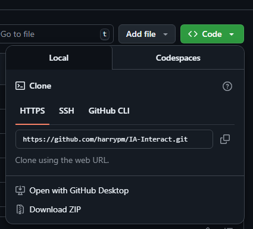
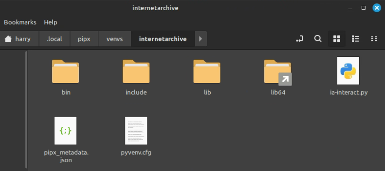
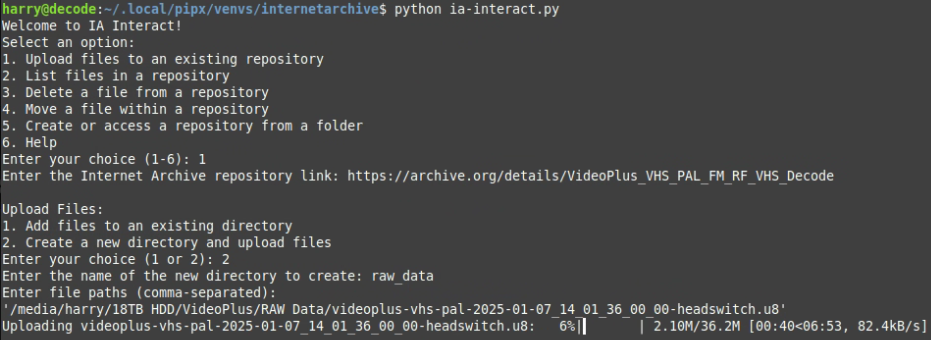

# Internet Archive Interact

An interactive command-line tool for managing Internet Archive repositories. 

Use this script to list files, upload files, download files, delete files, move files, and create new repositories with detailed metadata input. 

## Table of Contents

- [Internet Archive Interact](#internet-archive-interact)
  - [Table of Contents](#table-of-contents)
  - [Features](#features)
  - [Prerequisites](#prerequisites)
  - [Installation](#installation)
    - [1. Preparing Your System](#1-preparing-your-system)
    - [2. Setting Up the Script](#2-setting-up-the-script)
    - [3. Installing Python Libraries](#3-installing-python-libraries)
    - [4. Configuring Environment Variables](#4-configuring-environment-variables)
    - [5. Build Local Portable Binaries](#5-build-local-portable-binaries)
    - [6. GitHub Actions: Portable Releases](#6-github-actions-portable-releases)
    - [7. Windows Python Mode Notes (from issue #1)](#7-windows-python-mode-notes-from-issue-1)
    - [8. GUI Mode (Login + File Selection)](#8-gui-mode-login--file-selection)
    - [9. Account Profiles (S3 key manager)](#9-account-profiles-s3-key-manager)
    - [10. Progress Readout](#10-progress-readout)
- [Usage](#usage)
- [Running the Script](#running-the-script)
    - [Script Options](#script-options)
  - [Troubleshooting](#troubleshooting)
- [Full Breakdown and Feature Notes](#full-breakdown-and-feature-notes)
  - [Overview](#overview)
  - [Detailed Breakdown by Function](#detailed-breakdown-by-function)
    - [1. `get_repo_identifier(repo_link)`](#1-get_repo_identifierrepo_link)
    - [2. `upload_file_with_progress(identifier, file_path, directory, object_name=None)`](#2-upload_file_with_progressidentifier-file_path-directory-object_namenone)
    - [3. `list_repository_files(identifier)`](#3-list_repository_filesidentifier)
    - [4. `delete_file(identifier, file_path)`](#4-delete_fileidentifier-file_path)
    - [5. `move_file(identifier, file_name, source_dir, target_dir)`](#5-move_fileidentifier-file_name-source_dir-target_dir)
    - [6. `create_rules_file(folder_path)`](#6-create_rules_filefolder_path)
    - [7. `prompt_metadata()`](#7-prompt_metadata)
    - [8. `initialize_repository(folder_path, identifier, metadata, mode)`](#8-initialize_repositoryfolder_path-identifier-metadata-mode)
    - [9. `print_help()`](#9-print_help)
    - [10. `main()`](#10-main)
- [Creator Notes](#creator-notes)

## Features
- **Interactive Menu:** Choose options to list files, upload files, download files, delete or move files, or create a new repository.
- **Basic GUI Mode:** Includes a login page for S3 keys, repository file list selection for download, and local file list selection for upload.
- **Batch Folder Upload (GUI):** Add whole folders with the Add Folder button or by dragging & dropping them from your file manager; subfolder structure is preserved on upload.
- **Account Repository Browser (GUI):** A My Repositories profile page lists every archive.org item uploaded by the account's screenname, so any repository can be selected and loaded with one click.
- **Create Repository (GUI):** A Create Repository page (modeled on ia-gui's upload editor) builds a new item from the Local Files list: title, identifier with availability check and auto-suggestion from the title, description, subject tags, collection, optional creator / date / language / license, and custom key:value metadata.
- **IA Status & Offline Queue (GUI):** The account bar shows a live IA: Online / IA: Offline indicator (click it to re-check). While archive.org is unreachable, upload, download and repository-creation actions are queued and start automatically once IA is back online.
- **Folder Upload/Download (CLI):** Upload whole folders with their structure preserved, and download a single file, a whole folder, or everything from a directory-style listing.
- **Single Launcher:** One executable supports both modes (CLI by default, GUI via `--gui`).
- **Flexible Repository Input:** Accepts a plain identifier (for example `my_item`) or Archive URLs such as `/details/`, `/download/`, and `/metadata/`.
- **Test Mode & Permanent Mode:** Run in simulation (Test Mode, where no changes are made) or execute actual changes (Permanent Mode).
- **Metadata Support:** Input metadata including title, description, creator, date, language, license URL, collection, subject tags, and test item status.
- **Collection Options:** Supports collections such as `community`, `opensource`, `texts`, `movies`, `audio`, `image`, `etree`, `folksoundomy`, `games`, and `software`.
- **Progress Bars:** Uses `tqdm` to display file upload progress.
- **S3 Authentication:** Uses S3 access keys for secure communication with the Internet Archive, taken from environment variables or the active account profile saved by the GUI Account Manager.

## Prerequisites

Before you begin, ensure you have:
- A Linux environment (Ubuntu, Debian, etc.)
- Python 3 installed
- Tkinter support (`python3-tk` on Linux if your distro does not include it by default)
- S3 Access Keys from [Internet Archive](https://archive.org/account/s3.php)
- An active internet connection
- Internet Archive Python Tool

## Installation

### 1. Preparing Your System

Update Your System:

    sudo apt update && sudo apt upgrade -y

Install Python 3 and pip:

    sudo apt install -y python3 python3-pip

Install internet archive CLI via pipx:

    pipx install internetarchive

### 2. Setting Up the Script

**Download the Script into your home or internet archive folder**

- *Option 2: Clone from GitHub (if available):*

    git clone https://github.com/harrypm/IA-Interact.git

- *Option 3: Create the Script Manually:*

1. Open your text editor and create a file named `ia-interact.py`:
2. Paste the full script code into the file, then save and exit.

**(Optional) Make the Script Executable:**

   chmod +x ia-interact.py

### 3. Installing Python Libraries

**Install Required Libraries:**

   pip3 install requests tqdm tkinterdnd2

`tkinterdnd2` is optional at runtime; it enables drag & drop in the GUI (the GUI works without it, drag & drop is simply disabled).

**Verify the Library Installation:**

    pip3 show requests tqdm tkinterdnd2

### 4. Configuring Environment Variables

**Obtain Your S3 Access Keys:**

Retrieve your S3 keys from [Internet Archive Account Page](https://archive.org/account/s3.php).

**Set Up Environment Variables:**

The variable names are exactly `S3_ACCESS_KEY` and `S3_SECRET_KEY` (`IA_ACCESS_KEY` / `IA_SECRET_KEY` are also accepted as aliases). They are their own variables - do **not** paste the keys into the existing `PATH` variable; `PATH` only tells the OS where to find programs.

*Windows* (applies to the pre-built `ia-interact-windows-x86_64.exe` too):

Option A - graphical (permanent):
1. Start Menu -> search "Edit environment variables for your account" -> open it.
2. Click **New** under *User variables* -> name: `S3_ACCESS_KEY`, value: your access key. Repeat with `S3_SECRET_KEY`.
3. Fully close and re-open any terminal, or re-launch the `.exe` (already-open windows keep the old environment).

Option B - Command Prompt (permanent for new terminals):

    setx S3_ACCESS_KEY "your-access-key"
    setx S3_SECRET_KEY "your-secret-key"

Then close and re-open the terminal before running the app again.

Option C - PowerShell (current session only):

    $env:S3_ACCESS_KEY = "your-access-key"
    $env:S3_SECRET_KEY = "your-secret-key"

*macOS / Linux:* edit your shell configuration file (e.g., `~/.bashrc` or `~/.zshrc`) and add:

    export S3_ACCESS_KEY="your-access-key"
    export S3_SECRET_KEY="your-secret-key"

Replace `"your-access-key"` and `"your-secret-key"` with your actual keys.

**Reload the Configuration:**

   source ~/.bashrc

**Test the Environment Variables:**

*macOS / Linux:*

    echo $S3_ACCESS_KEY
    echo $S3_SECRET_KEY

*Windows (PowerShell):*

    echo $env:S3_ACCESS_KEY
    echo $env:S3_SECRET_KEY
### 5. Build Local Portable Binaries

Install build dependencies:

    pip3 install -r requirements-build.txt

Build a single-file Linux executable:

    pyinstaller --clean --onefile --name ia-interact ia-interact.py

Release icon asset used by packaged binaries:

    assets/icons/internet-archive.png

The binary will be output to:

    dist/ia-interact

On Windows, the file will be:

    dist/ia-interact.exe

Run CLI mode from the packaged binary:

    ./dist/ia-interact --cli

Run GUI mode from the same packaged binary:

    ./dist/ia-interact --gui

Build a Linux `.AppImage` (x86_64):

    chmod +x scripts/build-appimage.sh
    ./scripts/build-appimage.sh
The x86_64 AppImage will be output to:

    release/ia-interact-linux-x86_64.AppImage

Build a Linux `.AppImage` (arm64):

    APPIMAGE_ARCH=aarch64 ./scripts/build-appimage.sh

The arm64 AppImage will be output to:

    release/ia-interact-linux-aarch64.AppImage
### 6. GitHub Actions: Portable Releases

This repository includes:

    .github/workflows/build-binaries.yml

The workflow builds portable release artifacts for:
- Linux x86_64: `ia-interact-linux-x86_64.AppImage`
- Linux arm64: `ia-interact-linux-aarch64.AppImage`
- Windows x86_64: `ia-interact-windows-x86_64.exe`
- Windows arm64: `ia-interact-windows-arm64.exe`
- macOS universal (arm64 + x86_64): `ia-interact-macos-universal.app.zip`

These release targets use Internet Archive icon assets from `assets/icons/`.

Each run uploads these as workflow artifacts.
When you push a tag matching `v*` (for example `v1.0.0`), the workflow also publishes these files to the GitHub Release for that tag.
### 7. Windows Python Mode Notes (from issue #1)
Issue reference: `https://github.com/harrypm/IA-Interact/issues/1`

The issue confirms the script can be run directly on Windows with Python.

Recommended flow:
1. Install Python on Windows and enable **Add Python to PATH** during install.
2. Open `cmd` in the folder containing `ia-interact.py` (File Explorer address bar -> type `cmd`).
3. Install dependencies:

       python -m pip install requests tqdm tkinterdnd2

   (`tkinterdnd2` is optional; it enables GUI drag & drop.)

4. Run the tool:

       python -m ia-interact

   Alternative:

       python ia-interact.py

5. Configure S3 keys before use (recommended: environment variables rather than hardcoding keys in the script).
   - The issue notes also mention replacing `os.getenv("S3_ACCESS_KEY")` and `os.getenv("S3_SECRET_KEY")` inline in the script.
   - If you do that for troubleshooting, keep it local-only and do not commit secrets.

Large upload note from the issue:
- In the upload flow, choosing **new folder** is more reliable for large uploads.
- Using existing folder with `./` may return a `400` error.
### 8. GUI Mode (Login + File Selection)
Run the GUI:

    python3 ia-interact-gui.py

Or use the unified launcher:

    python3 ia-interact.py --gui

GUI flow:
1. Enter S3 access and secret keys on the login page.
2. Enter your repository URL or identifier (for example `archive.org/details/<id>`, `archive.org/download/<id>/...`, `archive.org/metadata/<id>`, or just `<id>`), or double-click one in the **My Repositories** list in the Repository panel (auto-listed from the account's saved screenname), or click **Browse Repositories** for the full list page.
3. Repository files (left list) are shown directory-style: folders are listed first with their contents indented, and each folder shows its file count (double-click a folder to collapse/expand it). Select individual files or a whole folder - selecting a folder selects every file it contains, so a whole folder can be downloaded in one action. Right-click a file or folder for a quick download menu (**Download This File** / **Download This Folder** / **Download Selected**).
4. Add local files (right list) to upload, in any of these ways:
   - **Add Files** selects individual files.
   - **Add Folder** recursively adds every file in a folder, subfolders included.
   - Drag & drop files or whole folders from your file manager onto the Local Files panel (needs the optional `tkinterdnd2` package; otherwise the panel notes that drag & drop is unavailable).
   - When files come from a folder, subfolder structure is preserved: each file uploads to `target directory/<folder name>/<subfolders>/<file>`. Untick **Keep folder name in upload path** to upload the folder's contents directly under the target directory.
5. Set target upload directory and run upload/download actions.
   - Upload can start directly from a valid repository field value.
   - Download requires a loaded repository file list.
   - Upload sends every file in the local list (use Remove Selected / Clear to trim it first); a warning is logged if two queued files would land on the same repository path.
6. **Create Repository** (account bar) opens a creation page that builds a new item from the Local Files list: title, identifier (auto-suggested from the title, validated against archive.org's identifier rules, with a **Check** button for availability), description, subject tags, collection (or a custom collection identifier), optional creator / date / language / license, and custom key:value metadata. Submitting uploads the files and submits the metadata in one step.
7. The **IA: Online / IA: Offline** indicator in the account bar shows archive.org reachability (click to re-check). While IA is offline, upload / download / create actions are queued in the **Queued - waiting for archive.org** panel and start automatically once IA is reachable again; **Try now** forces an immediate check, **Remove selected** drops queued items.

### 9. Account Profiles (S3 key manager)

The GUI can save named S3 account profiles so you do not have to re-enter keys each session.

- On the login screen, the **Saved Profile** dropdown lists profiles stored locally; selecting one fills in the keys. **Manage** opens the Account Manager to add, edit, or remove profiles.
- On the main screen, the **Accounts** button opens the Account Manager in switch mode; choosing a profile and clicking **Use** switches the active account live (no restart needed).
- In the Account Manager, fields are Profile name, S3 access key, S3 secret key (masked, with a **Show** toggle), optional IA screenname, and optional Notes. Duplicate names and empty key fields are rejected.
- The **IA screenname** is the username part of your archive.org profile URL (for example `archive.org/details/@yourname`); it is case-sensitive. It is only needed for the My Repositories page.
- **My Repositories** is integrated into the main window: the Repository panel's list view shows every archive.org item uploaded by the active account, auto-loaded from the profile's saved **IA screenname** as soon as you log in or switch accounts (**Refresh** re-loads it; double-clicking an entry fills the Repository field and loads that item's file list; saved-only items are tagged `[saved]`). If the profile has no screenname the list shows a hint instead. **Browse Repositories** (account bar) opens the full page with a filter box: enter one or more screennames separated by commas (`@names` and full profile URLs like `archive.org/details/@name` also work); both uploader search forms are combined so items appear no matter which uploader field they carry, wrong-case names are retried in lowercase, and items the account saved (favorites) can be included via **Include saved items**. **Use Selected** (or double-click) loads the chosen repository; **Open in Browser** shows its details page. After a successful load the screenname list is saved back to the profile, which also refreshes the main-window list view.
- Profiles are stored in `~/.config/ia-interact/accounts.json` (or `$XDG_CONFIG_HOME/ia-interact/accounts.json`) with `0600` permissions; the directory is `0700`.
- The CLI also reads the **active saved profile**: if `S3_ACCESS_KEY` / `S3_SECRET_KEY` are not set in the environment, CLI operations use the keys of the profile selected in the GUI Account Manager, so keys entered once in the GUI work in the `.exe` / CLI too.
- Keys are stored in plaintext. Rely on home-directory / full-disk encryption for protection at rest, and do not store keys on shared machines.

### 10. Progress Readout

The GUI shows a live progress readout for uploads and downloads:

- A progress bar and label show the current file index (`i/N`), filename, bytes transferred / total, percentage, and speed (bytes/s). For uploads, bytes are counted as the file is streamed to the S3 endpoint; for downloads, per chunk.
- **Cancel** stops the transfer: an in-progress download stops after the current chunk; the in-flight upload finishes, then remaining queued files are skipped. Action buttons are disabled while a transfer is running and re-enabled when it completes or is cancelled.

# Usage

# Running the Script

To execute the script, run:

    python3 ia-interact.py

To launch the GUI version, run:
    python3 ia-interact.py --gui
    python3 ia-interact-gui.py

To force CLI mode explicitly, run:
    python3 ia-interact.py --cli

To interact with a repo, you can use either the item identifier directly or a full Archive URL:

    xxxxxxxxxx
    https://archive.org/details/xxxxxxxxxx
    https://archive.org/download/xxxxxxxxxx/some/file.ext
    https://archive.org/metadata/xxxxxxxxxx

From AppImage output, run CLI mode:

    ./release/ia-interact-linux-x86_64.AppImage --cli

From the same AppImage, run GUI mode:

    ./release/ia-interact-linux-x86_64.AppImage --gui

The packaged app defaults to GUI mode on any stock launch (Explorer double-click, Start-Process, desktop launcher, or a plain run with no flags). Use `--cli` to get the interactive CLI menu, or pick option 8 inside the CLI to open the GUI.

### Script Options

When the script runs, it displays an interactive menu with the following options:

- **List Files:** Display the contents of an existing repository.
- **Upload Files:** Add files or whole folders to a repository (folders upload recursively and their structure is preserved).
- **Download Files:** Download a single file, a whole folder, or all files from a repository's directory-style listing to a local folder.
- **Delete/Move Files:** Manage files within a repository.
- **Create a New Repository:** Upload an entire folder and configure repository metadata.
- **Open the GUI (option 8):** Launch the graphical interface; a plain launch (no flags) opens the GUI by default, so this option is mainly handy when you are already in the CLI.

During repository creation, you will be prompted to:
- Input metadata (title, description, creator, date, language, license URL).
- Select a **collection** from the provided list.
- Enter **subject tags** (e.g., `music, history`).
- Specify if the repository is a **test item** (*Note: Test items are automatically deleted after 30 days*).
- Choose between **Test Mode** (simulate actions without an actual upload) and **Permanent Mode** (execute actual uploads).

## Troubleshooting

- **Missing Libraries:**  
  If you encounter errors about missing libraries, run:

   pip3 install requests tqdm

- **Environment Variables Not Set:**  
  The variable names must be exactly `S3_ACCESS_KEY` and `S3_SECRET_KEY` (or `IA_ACCESS_KEY` / `IA_SECRET_KEY`) - putting the keys into `PATH` does nothing. On Windows, set them via `setx` (then open a new terminal) or via "Edit environment variables for your account"; already-open windows keep the old environment, so re-launch the app after changing them. On macOS/Linux, define them in your shell configuration file and reload it:

   source ~/.bashrc

- **API or Network Issues:**  
  Verify that your S3 keys are correct and that your internet connection is stable.

- **Logging:**  
  To help with debugging, you can redirect output to a log file:

   python3 ia-interact.py > script_output.log 2>&1

# Full Breakdown and Feature Notes

## Overview

"IA Interact" is an interactive command-line tool designed to manage repositories on the Internet Archive. It supports operations such as:

- **Uploading Files:** Upload individual files or entire folders to an Internet Archive repository.
- **Listing Repository Contents:** Retrieve and display the contents of a repository using the metadata API.
- **Deleting Files:** Remove specified files from a repository.
- **Moving Files:** Change a file’s location within a repository by copying it and then deleting the original.
- **Downloading Files:** Download a single file, a whole folder, or all files from a repository to a local path (the CLI download menu shows a directory-style listing with folder file counts).
- **Creating a New Repository:** Upload a folder as a new repository and submit metadata.
- **User Interaction:** Offers an interactive menu with a help option, test mode (simulation) vs. permanent mode, and filtering to avoid showing files from ".thumbs" directories.

This script uses the Internet Archive’s S3-compatible interface and Metadata API, and it includes robust file upload logic (with chunking, progress bars, and retry strategies).

---

## Detailed Breakdown by Function

### 1. `get_repo_identifier(repo_link)`
- **Purpose:**  
  Extracts the repository identifier from either a full Internet Archive URL or a plain identifier.
- **How It Works:**  
  Normalizes and parses Archive URLs (`/details/`, `/download/`, `/metadata/`) and returns the item identifier.  
  If a plain identifier is provided, it is accepted directly. If input is invalid, it alerts the user and returns `None`.

---

### 2. `upload_file_with_progress(identifier, file_path, directory, object_name=None)`
- **Purpose:**  
  Uploads a file to a specified directory within a repository.
- **Key Features:**
  - **Chunking:** Reads the file in 2MB chunks.
  - **Progress Tracking:** Uses the `tqdm` library to display a real-time progress bar.
  - **Retry Logic:** Implements retry strategy (5 retries) using an HTTPAdapter.
  - **S3 Authentication:** Reads S3 keys from environment variables and includes them in the request headers.
  - **Folder Uploads:** `object_name` is the repository-side path and may contain `/`-separated subdirectories, so files collected from a local folder (via `collect_folder_files`) upload with their structure preserved. It defaults to the file's basename.
- **Note:**  
  The function sends HTTP PUT requests to the URL `https://s3.us.archive.org/{identifier}/{directory}/{object_path}` to perform the upload.

---

### 3. `list_repository_files(identifier)`
- **Purpose:**  
  Retrieves and lists the files in a repository.
- **Key Features:**
  - **Metadata API:** Sends a GET request to `https://archive.org/metadata/{identifier}` to fetch repository metadata (in JSON).
  - **Filtering:** Excludes any files that reside in directories with names ending in ".thumbs" (i.e. if any component of the path ends with ".thumbs").
  - **Display:** Prints out a numbered list of the filtered file names. `display=False` skips the printing; the download menu uses it to print its own directory-style listing instead (folders with file counts, built via `build_download_listing`).

---

### 4. `delete_file(identifier, file_path)`
- **Purpose:**  
  Deletes a file from the repository.
- **Key Features:**
  - **HTTP DELETE:** Sends a DELETE request to the S3 endpoint `https://s3.us.archive.org/{identifier}/{file_path}`.
  - **S3 Authentication:** Utilizes S3 credentials stored in environment variables.
  - **Feedback:** Notifies the user whether the file deletion succeeded (checks for HTTP 200 or 204).

---

### 5. `move_file(identifier, file_name, source_dir, target_dir)`
- **Purpose:**  
  Moves a file from one location in the repository to another.
- **Key Features:**
  - **Copy-Delete Approach:**  
    1. **Copy:** Uses an HTTP PUT request with the `x-amz-copy-source` header to copy the file to the target directory.
    2. **Delete:** If the copy is successful, deletes the original file.
  - **S3 Authentication:** Requires S3 keys from environment variables.
  - **Error Handling:** Provides error messages if the copy or delete fails.

---

### 6. `create_rules_file(folder_path)`
- **Purpose:**  
  Ensures that a local folder contains a `_rules.conf` file.
- **Key Features:**
  - **Default Rules:** If `_rules.conf` does not exist, it is created with the default content `CAT.ALL`.
  - **Usage:** This file can help control file visibility during repository uploads.

---

### 7. `prompt_metadata()`
- **Purpose:**  
  Collects metadata from the user required to create a new repository.
- **Collected Metadata Includes:**
  - **Basic Information:** Title, description, creator, date, language, license URL.
  - **Collection:** The user selects one from a predefined list (e.g., community, opensource, texts, movies, audio, image, etree, folksoundomy, games, software).
  - **Subject Tags:** A comma-separated list, such as "music, history".
  - **Test Item Flag:** A flag to indicate if the repository is a test item (if "yes" is entered, it sends "true"; if "no", the field is omitted).

---

### 8. `initialize_repository(folder_path, identifier, metadata, mode)`
- **Purpose:**  
  Uploads all files from a specified folder as a new repository.
- **Key Features:**
  - **Mode Selection:**  
    - **Test Mode:** Simulates the upload process without transferring any files.
    - **Permanent Mode:** Uploads each file via HTTP PUT requests.
  - **Recursive Upload:** Iterates through all files in the folder (using `os.walk`).
  - **Metadata Submission:** After file uploads, sends repository metadata via a POST request.

---

### 9. `print_help()`
- **Purpose:**  
  Displays a help message describing each menu option and its usage.
- **Features:**  
  Provides detailed instructions for each operation and references the official Internet Archive CLI documentation for further details.

---

### 10. `main()`
- **Purpose:**  
  Serves as the entry point of the script with an interactive menu.
- **Key Features:**
  - **Main Menu:** Displays options for uploading, listing, deleting, moving, and downloading files, creating a repository, or viewing help.
  - **Folder Support:** Upload (option 1) accepts files and/or folders — folders upload recursively with their structure preserved. Download (option 5) shows a directory-style listing and accepts a file or folder number; a folder number downloads every file in that folder.
  - **Conditional Prompts:**  
    - **For Existing Repositories (options 1–5):** Prompts for the repository URL after the option selection.
    - **For Folder-based Repository Creation (option 6):** Gathers folder path, mode, and metadata.
  - **Action Dispatch:** Calls the corresponding function based on the user’s selection.

# Creator Notes

This script was built using Microsoft Copilot, and 5 hours of Harry Munday's lifespan, Enjoy. 