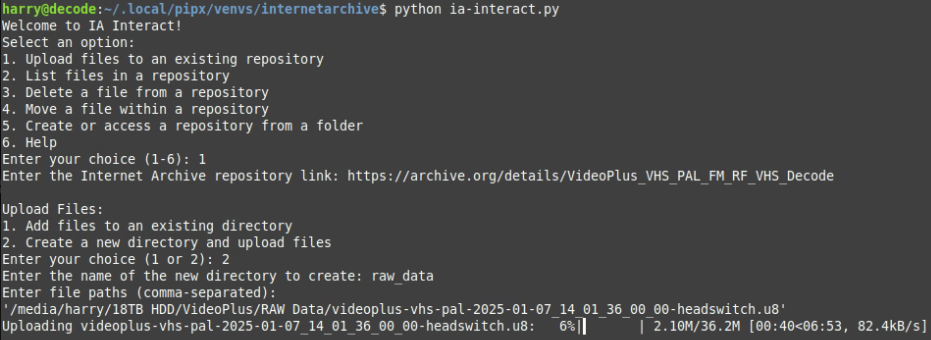

# IA Interact @TAG@

A native desktop client for uploading, downloading and managing Internet Archive repositories.

## Highlights

- **Create Repository page** — full item-creation form (title, identifier with availability check + slug auto-suggest, description, subject tags, collection, creator/date/language/license, custom key:value metadata), modeled on ia-gui's editor.
- **IA status indicator + offline queue** — live `IA: Online / Offline` badge; uploads, downloads and creations queue automatically while archive.org is unreachable and start when it's back.
- **Network profiles** — named proxy configs (direct / system / manual with optional auth) + connectivity test; all GUI archive.org traffic follows the active profile.
- **Folder view** — collapsible folder trees in both file viewers (folders start collapsed, `+`/`−` expand markers, folder-aware select/remove).
- **Retries selector (0 = unlimited)** — transfers retry transient failures with exponential backoff until they stick.
- **Skip existing** — identical files (name + repository path + size, md5-verified when available) are skipped, so re-running an interrupted upload resumes where it stopped.
- **Derivatives off by default** — items upload as-is (`x-archive-queue-derive: 0`); archive.org transcodes can be enabled per upload or triggered later from the item's page.
- **CLI parity** — the GUI gained delete/move file operations; credentials resolve from env vars or saved GUI profiles on both front-ends.
- **Clean launches** — windowed build (no empty console), GUI opens centered on the main monitor, dialogs open over the main window.

## Downloads

| Platform | File |
|---|---|
| Windows x86_64 | `ia-interact-windows-x86_64.exe` |
| Windows ARM64 | `ia-interact-windows-arm64.exe` |
| Linux x86_64 | `ia-interact-linux-x86_64.AppImage` |
| Linux ARM64 | `ia-interact-linux-aarch64.AppImage` |
| macOS (Apple Silicon + Intel) | `ia-interact-macos-universal.app.zip` |

## Notes

- S3 keys come from `S3_ACCESS_KEY` / `S3_SECRET_KEY` environment variables — or save them once in the GUI Account Manager (the CLI reuses the active profile).
- Get keys at [archive.org/account/s3.php](https://archive.org/account/s3.php). Keys never leave your machine except to authenticate with archive.org.
